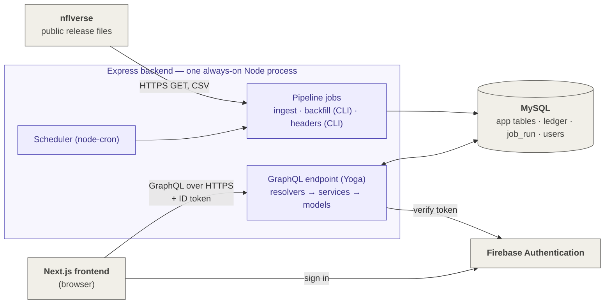

# System Design — Fantasy Workbench (Runpure FF)

**Status:** Draft v2.0 · **Owner:** William Sanchez · **Date:** 2026-11-09
**v2.0 (2026-11-09):** rewritten to match the accepted ADRs (ADR-0001 to ADR-0017). Removed: DuckDB, the storage bucket and its snapshot layout, Parquet and mart files, GitHub Actions as the pipeline host, Postgres and SQLite, the single repository, and the medallion layer names. The guardrail's ten requirements (§0) are kept word for word as the owner set them; a new column says how each is met now.
**v1.0–v1.4 (2026-11-05):** first drafts, written before the ADRs; superseded by v2.0.
**Purpose:** how the system is put together: components, boundaries, data flow, and how the multi-user guardrail is met. Each choice is decided in an ADR (`design/decisions/`); this document puts them in one picture and links to them. It decides nothing itself.
**Inputs:** PRDs (`prds/`), [`specs/ff-data-etl-storage-spec.md`](../specs/ff-data-etl-storage-spec.md), decision log [`design/architecture-decisions.md`](architecture-decisions.md).

---

## 0. Guardrail: multi-user ready, no rework (firm, ADR-0001)

**Rule:** the app launches with one user (you), but no design decision may require significant rework to serve many users. Start with a small deployment (one host, one instance) but never a single-user design. Growing to more users should mean adding resources (more instances, a bigger database, a separate worker), never changing the data model, the component boundaries or the code structure.

| # | Requirement | Why it avoids rework | How it's met |
|---|---|---|---|
| 1 | **A `users` table, and every account-owned row carries a `user_id`**: platform connections, sign-ins, leagues followed, settings, change log, preferences. You are user 1 | Adding ownership to every table and query later is the most expensive retrofit there is | `users` table in MySQL keyed to the Firebase `uid` (ADR-0015, ADR-0005) |
| 2 | **Real user accounts and login**, even with one account. No shared password or "access restricted to me" shortcut | Replacing an auth shortcut touches every endpoint | Firebase Authentication; every request carries an ID token (ADR-0015, ADR-0014) |
| 3 | **Every API request is scoped to the signed-in user.** No endpoint returns data without checking ownership | Retrofitting authorization means auditing every query | Token middleware puts the user in the GraphQL context; authorization lives in the services (ADR-0015, ADR-0017) |
| 4 | **Sign-ins stored per user, encrypted**, with the key outside the database | Per-user credentials are already the shape multi-user needs | Applies when platform connections are built (later phase) |
| 5 | **Stateless app server:** sessions, caches that matter and job state live in the database or bucket, never in process memory or on local disk | Lets a second instance run behind a load balancer with no code change | MySQL only, no bucket (ADR-0005). Job state in `ingest_ledger` and `job_run`; the run lock is a MySQL named lock (ADR-0006) |
| 6 | **Background work (league sync, live poller, mart load) runs as jobs separate from the web request path**, keyed by league rather than by user, so a league shared by two users is polled once | The worker can move to its own process or machine without a rewrite | Each job has its own entry point that the scheduler only calls, so jobs can move to a worker (ADR-0008). "Marts" are now the MySQL app tables (ADR-0005) |
| 7 | **The serving database must handle concurrent writes from more than one process and machine** | Required by rows 5 and 6 once there is more than one instance | MySQL (ADR-0005) |
| 8 | **Platform calls go through one rate-limit budget per platform**, not per request or per user | Prevents more users from turning into blocked accounts | Applies when platform connections are built (later phase) |
| 9 | **Shared data is computed once for everyone:** NFL data and marts are league-agnostic; league scoring is cached per league | Cost grows with leagues, not with users × screens | nflverse tables are shared reference data (ETL spec §0.1); points are calculated in the app from stored stats (ADR-0007) |
| 10 | **Schema changes only through migrations; contracts (mart schemas, API responses) are versioned** | Changes can roll out without breaking running instances or other users | Changed how it's met, not whether. Database: hand-applied statements kept in order in `sql/`, not a migration tool (ADR-0011). API: no version numbers; GraphQL schema evolution with `@deprecated` and a breaking-change check in CI (ADR-0016, ADR-0017) |

**What can stay small at launch** (scale the deployment, not the design): one backend host and one instance; the jobs inside the backend process; no load balancer; small database size; manual user creation (no public sign-up). These are allowances the guardrail permits, not decisions; how accounts are created is listed under "Not decided" in §3.

**Exceptions:** any decision that breaks a row above is recorded in an ADR with the rework it would cost and why it's still accepted (ADR-0001). None so far. ADR-0011 and ADR-0017 change *how* row 10 is met, not whether.

## 1. Requirements

**Functional** (from the PRDs): browse every NFL player; connect Sleeper, Yahoo and ESPN; view and later change lineups, claims and trades; game-day problem list and live board; waiver and trade tools; weekly review analytics.

**Phase 1** (Overview PRD): the player list, player card, and NFL scores and schedule, with nflverse data and no leagues connected.

**Non-functional**

| Requirement | Target | Source |
|---|---|---|
| Users | 1 at launch; many without rework (§0) | PRDs; ADR-0001 |
| Player list and stats freshness | ≤ 24 h; one pipeline run a day at 06:00 Eastern | Player explorer PRD; ETL spec D7 |
| League data freshness (later phase) | ≤ 15 min outside games, ≤ 60 s during games | Platform connections PRD |
| Changes on platforms (later phase) | Confirmed, then verified by re-reading the platform | Platform connections PRD |
| Sign-ins to platforms (later phase) | Encrypted at rest, never in the browser or in logs | Platform connections PRD |
| Rebuild | Every pipeline table can be rebuilt by downloading again (backfill) | ADR-0005, ADR-0006 |
| Cost | Low; personal project | Assumption |

**Constraints:** one developer; TypeScript for the backend (ADR-0008, ADR-0009), on Node 24 (ADR-0017); Next.js for the frontend (ADR-0002); MySQL only (ADR-0005).

**Load estimate:** one user. Phase 1 data is about 300 MB of CSV and about 515 MB in MySQL (ETL spec §7.3). The player list has about 1,250 fantasy-relevant rows; weekly player stats about 19,400 rows a season. Launch load doesn't size anything; simplicity and reliability do. Multi-user readiness is a design driver (§0).

## 2. High-level design

Purple: the backend process · Gray: outside services, the database, the browser. GitHub renders this diagram in the repo.

**Components**

| Component | What it does | Decided in |
|---|---|---|
| Next.js frontend | The screens. Calls the backend directly from the browser, with the user's Firebase ID token on every request | ADR-0002, ADR-0014 |
| Firebase Authentication | Sign-in. The backend verifies each ID token with the Firebase Admin SDK | ADR-0015 |
| Express backend | One always-on Node process, built as a layered modular monolith (routes, middleware, controllers/resolvers, services, models). Holds the API, the pipeline, its scheduler and the backfill command | ADR-0008 |
| GraphQL endpoint | GraphQL Yoga mounted on Express; schema written code-first with Pothos; only the web app's registered queries are accepted; per-request DataLoaders batch lookups | ADR-0017, ADR-0016 |
| Pipeline | Streams nflverse CSV files, maps columns by hand, loads staging tables and swaps each piece in one transaction | ADR-0006, ADR-0009, ADR-0012; ETL spec |
| MySQL | The only store: app tables, the ingest ledger, run records, users and account-owned rows. No raw files are kept | ADR-0005, ADR-0010, ADR-0011 |

**The boundary rule:** the pipeline handles league-agnostic data that needs no sign-in to any account (nflverse now; odds, rankings and the snapshot archiver later). Everything tied to a user's accounts and leagues belongs to platform connections, also inside the backend (ETL spec D15).

**Data flow**

1. At 06:00 Eastern each day, the scheduler starts an ingest run. It takes the MySQL run lock, checks each nflverse file's published version against the ledger, and loads only changed pieces (ADR-0006; ETL spec §5, §9).
2. Each piece streams into a staging table and replaces the live rows in one transaction; the ledger and `job_run` record the result (ETL spec §5.3).
3. The browser signs in with Firebase and sends GraphQL queries with the ID token. The backend verifies the token, resolves the query through services and models with hand-written SQL, and returns only the fields asked for (ADR-0014, ADR-0015, ADR-0017, ADR-0010).
4. Fantasy points are calculated in the app for the scoring format the user selects; they are never stored (ADR-0007).
5. Operators read run history through the GraphQL fields `pipelineRuns` and `ingestLedger` (ADR-0017).

## 3. Decisions this design rests on

| Question | Answer | ADR |
|---|---|---|
| One app, or a separate frontend and backend? | Separate: Next.js frontend, Express backend | ADR-0002, ADR-0008 |
| Backend structure | Layered modular monolith in one always-on Node process; jobs can move to a worker later | ADR-0008 |
| Language | TypeScript on Node | ADR-0008, ADR-0009 |
| Storage | MySQL only, no bucket, no raw files | ADR-0005 |
| Data sources | nflverse as the base; Sleeper's documented player list for injuries and depth (set aside for Phase 1) | ADR-0003, ADR-0004 |
| Loading | Backfill 2017–2026 once, then incremental; play-by-play and depth charts current season only | ADR-0006, ADR-0013 |
| Data access | Hand-written SQL with mysql2; no ORM; schema changes by hand; no transform library | ADR-0010, ADR-0011, ADR-0012 |
| Scoring | Calculated in the app from stored stats | ADR-0007 |
| Frontend to API | The browser calls the API directly over public HTTPS; CORS limited to the frontend's origin | ADR-0014 |
| Sign-in | Firebase Authentication | ADR-0015 |
| API style and contract | GraphQL (Yoga, Pothos, trusted documents); the GraphQL schema is the contract | ADR-0017, ADR-0016 |
| Who reads league data from the platforms (later phase) | The backend's platform connections, not the pipeline | ETL spec D15 |

**Not decided (tracked elsewhere):** how user accounts are created: public sign-up or created by you (no ADR yet; ADR-0015 covers sign-in only); hosting provider for the backend, the frontend and MySQL (decision log, open item 4; a deployment-phase decision); backup and recovery (ETL spec D16); monitoring and alerting (decision log, open item 7; its own PRD later); where projections come from (Waivers & trades PRD; the Overview's placeholder formula is used until then).

## 4. Deep dive

**Data ownership**

| Data | Owner | Store |
|---|---|---|
| nflverse tables (players, games, weekly stats, rosters, injuries, snaps, depth charts, play-by-play, teams) | Pipeline | MySQL (ETL spec §7.2) |
| Ingest ledger, run records | Pipeline | MySQL |
| Users and account-owned rows | API | MySQL, keyed to the Firebase `uid` |
| Leagues, rosters, matchups, transactions, platform sign-ins (later phase) | Platform connections, in the backend | MySQL; sign-ins encrypted, key outside the database (§0 row 4) |
| Live scores and lock status (later phase) | Platform connections' live tier | MySQL, disposable |

**API** (ADR-0014 to ADR-0017):
- One GraphQL endpoint over public HTTPS. CORS allows only the frontend's origin. Every request carries a Firebase ID token in the `Authorization` header, and a request without a valid token is rejected.
- The schema is written code-first with Pothos, printed to `schema.graphql` and committed. The frontend generates its types with GraphQL Code Generator.
- Only operations the web app registered at build time are accepted (persisted operations). Lists are paginated with caps, request bodies are capped, and requests are rate-limited.
- Changes are additive. A field is marked `@deprecated` before it's removed, and CI fails on breaking schema changes.
- The live board polls every 30–60 seconds at launch. Server-sent events are the upgrade path.
- Logs record each request's operation name and its `errors` array, because GraphQL can report failures inside an HTTP 200.

**Error handling**
- Pipeline: a failed piece leaves the live table untouched and is retried on the next run; structural problems block a load, value problems only warn (ETL spec §5.3, §8).
- Platform changes (later phase): confirm → send → re-read → mark done only if the platform matches; log every attempt (Platform connections PRD).

## 5. Reliability and monitoring

- **One backend host is a single point of failure.** Acceptable for one user. The pipeline can always be rebuilt from nflverse by running the backfill again (ADR-0005).
- **Overlap and restarts:** the MySQL named lock stops overlapping runs; on shutdown the scheduler stops starting runs and an interrupted run is redone safely (ADR-0006, ADR-0008).
- **Monitoring:** out of scope for now; a failure is visible in `job_run` and the logs (ETL spec D8).
- **Backups:** a deployment-phase decision (ETL spec D16). Research: [`research/mysql-hosting-options-research-2026-11-08.md`](../research/mysql-hosting-options-research-2026-11-08.md).

## 6. Repositories → Three

| Repository | Holds | Deploys |
|---|---|---|
| `runpure-ff-planning` (this one) | PRDs, system design, ADRs, specs, research, templates, doc checks | Nothing |
| `runpure-ff-backend` | Express server: GraphQL API, pipeline, scheduler, backfill, `sql/` schema statements, `schema.graphql` | The backend process |
| `runpure-ff-frontend` | Next.js app; generated GraphQL types; the list of registered queries, copied to the backend with every query change (ADR-0016) | The frontend |

The backend and frontend are separate apps in separate repos (ADR-0008). The GraphQL schema file and the persisted-documents file are the only artifacts shared between them (ADR-0016).

## 7. Trade-offs accepted

| Choice | Gives up | ADR |
|---|---|---|
| MySQL only, no raw files | Re-parsing an old download without fetching it again | ADR-0005 |
| One always-on backend process for API and jobs | Isolation between a heavy job and API response times, until jobs move to a worker | ADR-0008 |
| Hand-written SQL, no ORM, schema changes by hand | Generated types and automated migrations | ADR-0010, ADR-0011 |
| Browser calls the API directly | A private backend address; the API is public and must check every token | ADR-0014 |
| GraphQL | Simpler REST for Phase 1, free HTTP caching, status-code monitoring | ADR-0017 |
| Current-season-only play-by-play and depth charts | Historical play-by-play analytics | ADR-0013 |
| Placeholder projections | Trade-tool quality until projections are decided | Waivers & trades PRD |

## 8. Revisit as it grows

- More users → no redesign (§0): add backend instances, move jobs to a separate worker (ADR-0008's upgrade trigger), enlarge the database, open sign-up.
- Live board latency → server-sent-event subscriptions instead of polling (ADR-0017).
- Outside API clients → add depth, alias and cost limits alongside trusted documents (ADR-0017).
- Projections → a separate modeling component if built.
