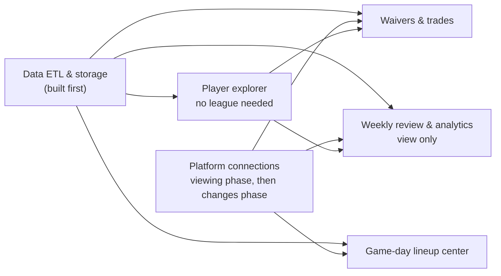

# Fantasy Workbench — PRD Overview

**Four features and two infrastructure pieces, each in its own file in `prds/`. This page holds what they share: how they fit together, what each platform allows, and the terms every page uses.**

**Created:** 2026-11-04 · **Owner:** William Sanchez · **Last updated:** 2026-11-09 (moved from the online PRD doc into the planning repo; multi-user design (ADR-0001), document locations and the dependency diagram brought up to date)

Fantasy Workbench is a personal web app for managing all of your fantasy football leagues on Sleeper, Yahoo and ESPN from one place. You are the first user, and the only one at launch; the app is designed so more users can be added without rework ([ADR-0001](../design/decisions/ADR-0001-design-for-multiple-users-from-day-one.md)). There are no real-money features and no public launch, so success means fewer missed lineup decisions and less time spent, not sign-ups or revenue.

## How to read each page

Every feature and infrastructure page uses the same sections in the same order (template: [`governance/templates.md`](../governance/templates.md) §2). A section with nothing in it says "None". Data ETL & storage adds a few sections of its own: scope, who it serves, sources, outputs and risks.

| Section | What it tells you |
| --- | --- |
| At a glance | Who it's for, when it arrives, what it needs first |
| What success looks like · How we'll measure it | The targets, and how you'll know they were met |
| Not doing | What's deliberately left out, and why |
| Must have for launch | The feature isn't done without these |
| Should have soon after | Comes right after launch; the feature works without them |
| Later | Parked ideas the design shouldn't rule out |
| Open questions | What still needs an answer, and whether it blocks building |

## How the features fit together

Arrows point from what is needed to what needs it, as listed in the table below.

Player explorer needs no league, so it's built first. Every league-based feature waits until Platform connections can view data. Weekly review & analytics never makes changes, so it has no second-phase work.

**Phase 1** recreates Sleeper's screens with no leagues connected: the player list, player cards, and NFL scores and schedule, filled with player and NFL data. League integration (Platform connections) starts in a later phase. A screen that needs a league to make sense may use a simulated redraft league.

**Phase names used on every page:**

| Phase | What it covers |
| --- | --- |
| **Phase 1** | No leagues: the player list, player card, and NFL scores and schedule, from nflverse data |
| **Viewing phase** | The first league phase: Platform connections reads your leagues, and league features show data but change nothing |
| **Changes phase** | The second league phase: the app makes changes on platforms that allow them (Yahoo first, then Sleeper) |

## Features and infrastructure

| Page | Type | Journey it serves | Viewing data | Making changes | Needs first |
| --- | --- | --- | --- | --- | --- |
| [Player explorer](feature-player-explorer.md) | Feature PRD | Looking up and comparing any player | Before anything else, no league needed | None, view only | Data ETL & storage |
| [Game-day lineup center](feature-game-day-lineup-center.md) | Feature PRD | Game-day lineup check; following games live | Viewing phase | Changes phase | Platform connections, Data ETL & storage |
| [Waivers & trades](feature-waivers-and-trades.md) | Feature PRD | Waiver night; weighing a trade | Viewing phase | Changes phase | Player explorer, Platform connections, Data ETL & storage, shared terms |
| [Weekly review & analytics](feature-weekly-review-and-analytics.md) | Feature PRD | Weekly review | Viewing phase (already working on sample data) | None, view only | Player explorer, Platform connections, Data ETL & storage |
| [Platform connections](infra-platform-connections.md) | Technical PRD | Every league-based journey | Viewing phase | Changes phase: Yahoo, then Sleeper | Data ETL & storage (the nflverse `player` table its player crosswalk maps to) |
| [Data ETL & storage](infra-data-etl-and-storage.md) | Technical PRD | Every journey: supplies all the data | Built first | None, read only | Nothing |

## How the documents fit together

PRDs say what's needed and why; implementation specs say how it's built; ADRs record each architectural decision; the system design shows how the parts fit. All of them live in the planning repo (`runpure-ff-planning`), one home each ([`governance/documentation-suite.md`](../governance/documentation-suite.md)). Code repos link to them and keep no copies.

| Document | Type | Answers | Where it lives |
| --- | --- | --- | --- |
| Player explorer, Game-day lineup center, Waivers & trades, Weekly review & analytics | PRD | What you need and why | `prds/feature-*.md` |
| Platform connections | Technical PRD | What the features need from Sleeper, Yahoo and ESPN | [`prds/infra-platform-connections.md`](infra-platform-connections.md) |
| Data ETL & storage | Technical PRD | What the features need from the data layer | [`prds/infra-data-etl-and-storage.md`](infra-data-etl-and-storage.md) |
| Data ETL & storage spec | Implementation spec | How the data layer is built | [`specs/ff-data-etl-storage-spec.md`](../specs/ff-data-etl-storage-spec.md) |
| A spec for each other PRD | Implementation spec | How each piece is built | `specs/`, written just before that piece is built |
| System design | Design doc | How the parts fit together | [`design/system-design.md`](../design/system-design.md) |
| ADRs and decision log | Decision records | Each architectural decision and why | `design/decisions/`, [`design/architecture-decisions.md`](../design/architecture-decisions.md) |

## What each platform allows

| Platform | How you sign in | Viewing data | Making changes |
| --- | --- | --- | --- |
| **Sleeper** | Your username; Sleeper has no "sign in with" option | Official public API, free, up to 1,000 requests a minute | Unofficial: only through Sleeper's private system using your sign-in token. Could break or be blocked |
| **Yahoo** | Yahoo's own sign-in page, through a Yahoo developer app you register | Official API | Official API. Adding and dropping players is known to work; lineup changes not yet confirmed |
| **ESPN** | Two cookies copied from your browser while signed in to espn.com | Unofficial, undocumented. ESPN changed it once already, in 2019 | Unofficial and the least documented of the three |

Viewing data: Sleeper and Yahoo are official and supported; ESPN is unofficial. Making changes: Yahoo is official; Sleeper works but isn't officially supported; ESPN is unofficial and least reliable.

## Shared terms

Every page uses these definitions. A number shown in the app always means exactly this.

| Term | What it means |
| --- | --- |
| **League** | One league on one platform, for the current season |
| **What a league allows** | A record for each league of what the app can do there: view, set lineup, add or drop, claim, trade |
| **Projection** | (2 × the player's baseline average + total points in games played) ÷ (2 + games played), adjusted up or down by at most 15% for the opponent. Questionable players are reduced by 10%. Out, injured reserve or bye = 0. A placeholder until real projections are built |
| **Matchup difficulty** | The opponent's rank for fantasy points allowed per game to that position: 1st = fewest allowed, 32nd = most. 25th or worse is Easy; 8th or better is Tough |
| **Volatility** | How much a player's weekly points swing (standard deviation), over games actually played, with at least 3 games |
| **Bench points** | The best lineup you could have set from that week's roster, minus the score you actually got |
| **All-play record** | Your wins and losses if you'd played every other team every week |
| **Luck** | Your actual wins minus the wins your all-play record would predict |
| **Power score** | 60% season points per week + 25% last-3-weeks points per week + 15% all-play win rate, scaled to the top team's points per week |
| **Win probability** | How likely a lineup is to win, from the gap between both teams' projections and how much their players' scores usually swing |
| **Positional strength** | Points per week from a team's best starters: one quarterback, two running backs, two wide receivers, one tight end |

## Sources

- [Sleeper API client: rate limit, read-only access](https://awesome.ecosyste.ms/projects/github.com%2Flum8rjack%2Fsleeper-go)
- [Sleeper tool that makes changes using a sign-in token](https://glama.ai/mcp/servers/bealmot/sleeper-mcp/tools/setup_token)
- [Yahoo Fantasy API module: Yahoo sign-in, adding and dropping players](https://github.com/whatadewitt/yahoo-fantasy-sports-api)
- [ESPN Fantasy Football API client: cookies, 2019 change](https://www.npmjs.com/package/espn-fantasy-football-api)
