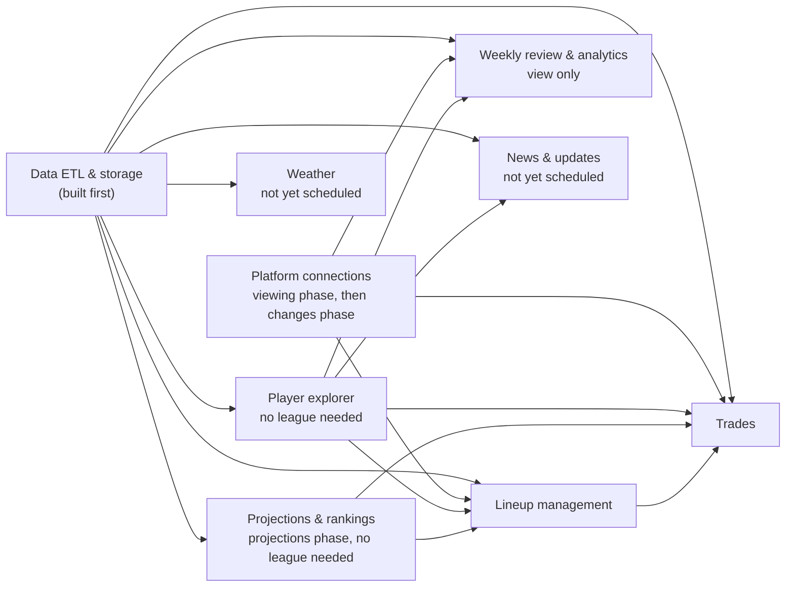

# Fantasy Workbench — PRD Overview

**The feature and infrastructure PRDs, each in its own file in `prds/`. This page holds what they share: how they fit together, what each platform allows, the terms every page uses, and the deferred features not yet scheduled.**

**Created:** 2026-11-04 · **Owner:** William Sanchez · **Last updated:** 2026-11-18 (PRD review applied — live-data/snapshot/verification contract, capability matrix, league-aware terms ([2026-11-18 review](../design/reviews/2026-11-18-chatgpt_PRD_Review_and_Recommendations.docx)); same day, the owner's restructure: Waivers & trades split into Lineup management — absorbing Game-day lineup center — and Trades; News & updates, Weather and Projections & rankings PRDs added; Deferred features section added; deployment held until real league integration). Earlier 2026-11-15 (IDP default-scoring definition added to Shared terms during the prototype→PRD reconciliation). Earlier 2026-11-09 (moved from the online PRD doc into the planning repo; multi-user design (ADR-0001), document locations and the dependency diagram brought up to date)

Fantasy Workbench is a personal web app for managing all of your fantasy football leagues on Sleeper, Yahoo and ESPN from one place. You are the first user, and the only one at launch; the app is designed so more users can be added without rework ([ADR-0001](../design/decisions/ADR-0001-design-for-multiple-users-from-day-one.md)). There are no real-money features and no public launch, so success means fewer missed lineup decisions and less time spent, not sign-ups or revenue.

## How to read each page

Every feature and infrastructure page uses the same sections in the same order (template: [`governance/templates.md`](../governance/templates.md) §2). A section with nothing in it says "None". Data ETL & storage adds a few sections of its own: scope, who it serves, sources, outputs and risks.

| Section | What it tells you |
| --- | --- |
| At a glance | Who it's for, when it arrives, what it needs first — and its **Status**: where the PRD stands in the SDLC |
| What success looks like · How we'll measure it | The targets, and how you'll know they were met |
| Not doing | What's deliberately left out, and why |
| Must have for launch | The feature isn't done without these |
| Should have soon after | Comes right after launch; the feature works without them |
| Later | Parked ideas the design shouldn't rule out |
| Open questions | What still needs an answer, and whether it blocks building |

**SDLC stages used in every Status row** (requirements → design → build → verification → in use → deployed):

| Stage | Meaning |
| --- | --- |
| **Requirements** | The PRD is written; no implementation spec or code yet |
| **Design** | The implementation spec is being written or reviewed |
| **Build** | Code is being written to the spec |
| **Verification** | Built; being tested against the PRD's success measures |
| **In use (local)** | Merged and used day to day, running locally; hosted deployment deferred |
| **Deployed** | Running hosted (none yet — deployment waits for real league integration) |

## How the features fit together

Arrows point from what is needed to what needs it, as listed in the table below.

Player explorer needs no league, so it's built first. Projections & rankings also needs no league, so its phase runs alongside the league work. Every league-based feature waits until Platform connections can view data. Weekly review & analytics never makes changes, so it has no second-phase work.

**Phase 1** recreates Sleeper's screens with no leagues connected: the player list, player cards, and NFL scores and schedule, filled with player and NFL data. League integration (Platform connections) starts in a later phase. A screen that needs a league to make sense may use a simulated redraft league.

**Phase names used on every page:**

| Phase | What it covers |
| --- | --- |
| **Phase 1** | No leagues: the player list, player card, and NFL scores and schedule, from nflverse data |
| **Viewing phase** | The first league phase: Platform connections reads your leagues, and league features show data but change nothing |
| **Projections phase** | The private [Projections & rankings](feature-projections-and-rankings.md) model replaces the placeholder numbers. Needs no league data, so it runs after Phase 1 alongside the Viewing phase (owner, 2026-11-18) |
| **Changes phase** | The second league phase: the app makes changes on platforms that allow them (Yahoo first, then Sleeper) |

**Deployment:** the hosting decision and deployment preparation begin now (owner, 2026-11-19, lifting the 2026-11-18 deferral): hosting research → hosting ADR(s) → MTDP → production hardening. The existing deploy gates are unchanged (MTDP before the first hosted deploy; the auth milestone before the app is publicly reachable — the backend refuses production with auth disabled). Until deployed, everything runs locally.

## Features and infrastructure

| Page | Type | Journey it serves | Viewing data | Making changes | Needs first |
| --- | --- | --- | --- | --- | --- |
| [Player explorer](feature-player-explorer.md) | Feature PRD | Looking up and comparing any player | Before anything else, no league needed | None, view only | Data ETL & storage |
| [NFL scores & schedule](feature-nfl-scores-and-schedule.md) | Feature PRD | Every game by week: scores, byes, detail | Phase 1, no league needed | None, view only | Data ETL & storage |
| [Lineup management](feature-lineup-management.md) | Feature PRD | The weekly roster loop: game-day check and live board, waivers, adds/drops, starts/sits; weekly team snapshots | Viewing phase | Changes phase | Player explorer, Platform connections, Data ETL & storage, Projections & rankings, shared terms |
| [Trades](feature-trades.md) | Feature PRD | Weighing, hunting and executing trades; the private buy/sell list | Viewing phase | Changes phase | Player explorer, Platform connections (live roster/settings reads), Data ETL & storage, Projections & rankings; Lineup management's snapshots for history only |
| [Weekly review & analytics](feature-weekly-review-and-analytics.md) | Feature PRD | Weekly review | Viewing phase (already working on sample data) | None, view only | Player explorer, Platform connections, Data ETL & storage |
| [News & updates](feature-news-and-updates.md) | Feature PRD | Staying current without leaving the app | Not yet scheduled | None, view only | Data ETL & storage, Player explorer |
| [Weather](feature-weather.md) | Feature PRD | Forecast conditions for upcoming games | Not yet scheduled | None, view only | Data ETL & storage, NFL scores & schedule |
| [Projections & rankings](feature-projections-and-rankings.md) | Feature PRD | Our own projections and rankings behind every number | Projections phase | None, view only — output feeds other features | Data ETL & storage |
| [Platform connections](infra-platform-connections.md) | Technical PRD | Every league-based journey | Viewing phase | Changes phase: Yahoo, then Sleeper | Data ETL & storage (the nflverse `player` table its player crosswalk maps to) |
| [Data ETL & storage](infra-data-etl-and-storage.md) | Technical PRD | Every journey: supplies all the data | Built first | None, read only | Nothing |

## How the documents fit together

PRDs say what's needed and why; implementation specs say how it's built; ADRs record each architectural decision; the system design shows how the parts fit. All of them live in the planning repo (`runpure-ff-planning`), one home each ([`governance/documentation-suite.md`](../governance/documentation-suite.md)). Code repos link to them and keep no copies.

| Document | Type | Answers | Where it lives |
| --- | --- | --- | --- |
| Player explorer, NFL scores & schedule, Lineup management, Trades, Weekly review & analytics, News & updates, Weather, Projections & rankings | PRD | What you need and why | `prds/feature-*.md` |
| Platform connections | Technical PRD | What the features need from Sleeper, Yahoo and ESPN | [`prds/infra-platform-connections.md`](infra-platform-connections.md) |
| Data ETL & storage | Technical PRD | What the features need from the data layer | [`prds/infra-data-etl-and-storage.md`](infra-data-etl-and-storage.md) |
| Data ETL & storage spec | Implementation spec | How the data layer is built | [`specs/ff-data-etl-storage-spec.md`](../specs/ff-data-etl-storage-spec.md) |
| A spec for each other PRD | Implementation spec | How each piece is built | `specs/`, written just before that piece is built |
| System design | Design doc | How the parts fit together | [`design/system-design.md`](../design/system-design.md) |
| ADRs and decision log | Decision records | Each architectural decision and why | `design/decisions/`, [`design/architecture-decisions.md`](../design/architecture-decisions.md) |

## What each platform allows

| Platform | How you sign in | Viewing data | Making changes |
| --- | --- | --- | --- |
| **Sleeper** | Your username; Sleeper has no "sign in with" option | Official public API, free, no key, up to 1,000 requests a minute | No official way. Community tools use Sleeper's private system with your sign-in token — against Sleeper's terms, could break or be blocked |
| **Yahoo** | Yahoo's own sign-in page, through a Yahoo developer app you register | Official API — but since mid-2026 behind a mandatory, human-reviewed access application (personal use is a permitted category) | Official API, fully documented (lineups, add/drop, claims, trades) — but Yahoo no longer grants write access to new apps; only legacy app credentials can write |
| **ESPN** | Two cookies copied from your browser while signed in to espn.com | Unofficial, undocumented. ESPN changed it in 2019 and again in 2024; ESPN's terms prohibit automated access | Unofficial and the least documented of the three |

Viewing data: Sleeper is official and open; Yahoo is official behind an application; ESPN is unofficial. Making changes: no platform currently offers an open, official write path — Yahoo's is documented but gated, Sleeper's and ESPN's are unofficial. Full facts with sources: [platform API research, 2026-11-18](../research/platform-apis-sleeper-yahoo-espn-research-2026-11-18.md); the pending decisions this raises: [open-decisions review](../design/reviews/2026-11-18-platform-integration-open-decisions.md).

## Shared terms

Every page uses these definitions. A number shown in the app always means exactly this.

| Term | What it means |
| --- | --- |
| **League** | One league on one platform, for the current season |
| **What a league allows** | A per-league **capability contract**, tracked per capability: read rosters, read settings, read claims, read trades, set lineup, immediate add/drop, submit/modify/cancel claim, send/accept/reject trade. Each is marked supported, unsupported, unknown or temporarily unavailable, with its last verified time. Reading never implies writing — where a write isn't safely supported, the app links to the platform |
| **Live league data** | The source of truth for current decisions. Every lineup recommendation, waiver decision, free-agent ranking, roster lookup and trade evaluation uses current rosters and relevant league settings supplied or revalidated through Platform connections, revalidated again immediately before any write. When current data can't be verified the app fails closed: no write is presented as safe, and a snapshot is never substituted without being clearly marked non-actionable. Caching is allowed, but every decision surface shows its last-verified time |
| **Historical snapshots** | History, never decision input. Weekly snapshots of every connected team's roster, matchup and score, plus league-settings snapshots at least daily while a league is active and on any detected change — each with source and capture timestamps, so any past week can be read under the rules that applied then. They serve analytics, audit and comparison only |
| **Verified platform action** | A requested change moves through explicit states: awaiting confirmation → submitting → awaiting verification → verified / failed / unable to verify. Only a matching read-back from the platform counts as verified. A timed-out or ambiguous outcome stays visibly unresolved and is never retried automatically |
| **Projection** | (2 × the player's baseline average + total points in games played) ÷ (2 + games played), adjusted up or down by at most 15% for the opponent. Questionable players are reduced by 10%. Out, injured reserve or bye = 0. This-week availability and rest-of-season value are distinct horizons: a current bye or short injury never zeroes a player's rest-of-season value. A placeholder until the [Projections & rankings](feature-projections-and-rankings.md) model replaces it (Projections phase) |
| **Matchup difficulty** | The opponent's rank for fantasy points allowed per game to that position: 1st = fewest allowed, 32nd = most. 25th or worse is Easy; 8th or better is Tough |
| **Volatility** | How much a player's weekly points swing (standard deviation), over games actually played, with at least 3 games |
| **Bench points** | The best lineup you could have set from that week's roster, minus the score you actually got |
| **All-play record** | Your wins and losses if you'd played every other team every week |
| **Luck** | Your actual wins minus the wins your all-play record would predict |
| **Power score** | 60% season points per week + 25% last-3-weeks points per week + 15% all-play win rate, scaled to the top team's points per week |
| **Win probability** | How likely a lineup is to win, from the gap between both teams' projections and how much their players' scores usually swing |
| **Positional strength** | Points per week from a team's best legal starters under that league's actual roster rules — flex/superflex and any supported IDP slots included. With no league connected, the default lineup is one quarterback, two running backs, two wide receivers, one tight end. Raw positional totals are never compared across incompatible roster formats |
| **IDP scoring** *(IDP removed from Phase 1 — owner 2026-11-17, player spec PE5; definition kept for a later phase)* | Default fantasy points for individual defensive players (DB, DL, LB) until a league sets its own: tackle 1, assisted tackle 0.5, sack 2, interception 3, pass defended 1, forced fumble 2, fumble recovery 2, tackle for loss 0.5, defensive touchdown 6. Provisional — whether IDP belongs in the default column set or should be opt-in is still open |

## Deferred features — high priority, not yet scheduled

Recorded here as placeholders (owner, 2026-11-18). Each gets its own PRD when it is scheduled; nothing in the current design may rule them out.

| Feature | What it covers | Needs first |
| --- | --- | --- |
| **Data-driven recommendations** | Proactive, model-generated waiver pickups and trade offers, surfaced inside [Lineup management](feature-lineup-management.md) and [Trades](feature-trades.md). Distinct from the user-initiated, rules-based calculations already in those PRDs (a legal bench replacement, eligible free agents ranked by projected gain, a trade delta) | [Projections & rankings](feature-projections-and-rankings.md) proven; connected leagues |
| **Automated notifications** | Push/email when news breaks on a rostered player, a lineup problem appears, or a deadline nears | A delivery channel; [News & updates](feature-news-and-updates.md); the surfaces that generate the events |
| **AI-generated articles** | Written summaries and stories generated from our own data and news | [News & updates](feature-news-and-updates.md); [Projections & rankings](feature-projections-and-rankings.md) |
| **Detailed matchup analysis** | An AI-generated report per matchup, with hard usage limits — potentially monetizable | [Projections & rankings](feature-projections-and-rankings.md); connected leagues |
| **Agentic lineup management** | The app updates lineups automatically from projections and takes immediate action on qualifying news (automatic waiver pickups, lineup changes) under rules you set | [Lineup management](feature-lineup-management.md) changes proven reliable; [Projections & rankings](feature-projections-and-rankings.md); [News & updates](feature-news-and-updates.md) |

## Sources

- [Sleeper API client: rate limit, read-only access](https://awesome.ecosyste.ms/projects/github.com%2Flum8rjack%2Fsleeper-go)
- [Sleeper tool that makes changes using a sign-in token](https://glama.ai/mcp/servers/bealmot/sleeper-mcp/tools/setup_token)
- [Yahoo Fantasy API module: Yahoo sign-in, adding and dropping players](https://github.com/whatadewitt/yahoo-fantasy-sports-api)
- [ESPN Fantasy Football API client: cookies, 2019 change](https://www.npmjs.com/package/espn-fantasy-football-api)
