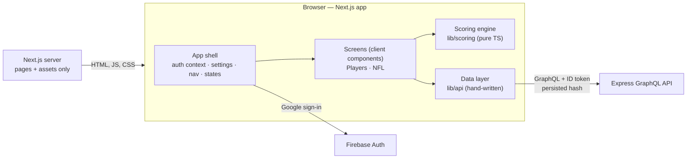

# Implementation Spec — Frontend Foundation

**Next.js app shell, repo architecture, configuration and build for `runpure-ff-frontend`.**

**Date:** 2026-11-16 · **Version:** v1.0 · **Status:** Draft for owner review. No code exists yet; nothing here is implemented.
**Companion to:** [`prds/00-overview.md`](../prds/00-overview.md), [`design/interface-design-brief.md`](../design/interface-design-brief.md), [`design/design-language.md`](../design/design-language.md).
**Siblings (the screens):** `specs/ff-player-explorer-spec.md` and `specs/ff-nfl-scores-and-schedule-spec.md` (written with this spec); each covers one feature PRD and builds on this foundation.
**Reference implementation:** the Phase 1 prototype at [`prototypes/phase1/`](../prototypes/phase1/) — the behavior source of truth per the brief. Divergences from it are listed in §14.
**Shape:** follows the ETL spec's structure, per [`governance/documentation-suite.md`](../governance/documentation-suite.md) §3.

---

## 0. Decisions

### 0.1 ADRs this spec implements

| ADR | What it means here |
|---|---|
| [ADR-0001](../design/decisions/ADR-0001-design-for-multiple-users-from-day-one.md) | Settings are stored per account (§8); nothing assumes a single user; signed-in account shown in the shell |
| [ADR-0002](../design/decisions/ADR-0002-build-the-phase-1-web-app-with-nextjs.md) | Next.js is the framework; the repo builds with `next build` and runs with `next start` |
| [ADR-0007](../design/decisions/ADR-0007-calculate-fantasy-points-in-the-app-from-stored-stats.md) | "The app" that calculates fantasy points is this frontend: the scoring engine in §11. The API returns stat lines, never points |
| [ADR-0014](../design/decisions/ADR-0014-call-the-express-api-directly-from-the-browser.md) | The browser calls the Express API directly; the Next.js server serves pages and assets only (§2) |
| [ADR-0015](../design/decisions/ADR-0015-authenticate-users-with-firebase-authentication.md) | Firebase Authentication in the browser; every API request carries the ID token (§5, §6) |
| [ADR-0016](../design/decisions/ADR-0016-define-the-api-contract-in-the-graphql-schema.md) | Types generated from the backend's committed `schema.graphql`; the codegen run writes the persisted-documents file that is copied to the backend (§6.2) |
| [ADR-0017](../design/decisions/ADR-0017-use-graphql-for-the-backend-api.md) | One GraphQL endpoint; persisted operations only; GraphQL errors can arrive inside HTTP 200 and are unwrapped and logged by operation name (§6.1, §6.5) |

### 0.2 Decisions (owner, 2026-11-16)

Decided by the owner during frontend planning. F3, F5 and F6 are construction-technique decisions that get ADRs of their own (owed; recorded after this spec is reviewed).

| ID | Section | Decision |
|---|---|---|
| F1 | — | Frontend specs are split per PRD: this foundation spec plus one spec per feature PRD (Player explorer; NFL scores and schedule) |
| F2 | §6.4, §7 | The frontend specs define the GraphQL contract additions the screens need; the backend implements them. Until they land, screens build against a sample data source behind the data-layer interface |
| F3 | §9 | Styling is CSS Modules per component over the shared [`design/tokens.css`](../design/tokens.css) custom properties. No styling framework. Recorded in [ADR-0018](../design/decisions/ADR-0018-style-the-frontend-with-css-modules-over-the-shared-design-tokens.md) |
| F4 | §5 | Sign-in is **Google only** in Phase 1. The prototype's email/password form and Apple button are not built |
| F5 | §6 | The GraphQL **request layer is hand-written**: fetch + Firebase token + persisted-operation hash. **Caching is TanStack Query** (revised by the owner 2026-11-16 after a cited review). No GraphQL client library (no Apollo Client, no urql) — a normalized cache is not needed by read-only screens. Recorded in [ADR-0019](../design/decisions/ADR-0019-call-the-graphql-api-through-a-hand-written-request-layer-with-tanstack-query-for-caching.md) |
| F6 | — | The player table is **hand-rolled**, including fixed-height row virtualization. No table library. Detailed in the Player explorer spec. Recorded in [ADR-0020](../design/decisions/ADR-0020-build-the-player-table-by-hand-with-fixed-height-virtualization.md) |
| F7 | §8 | Settings persist server-side per account (the PRD must-have), with a local mirror for instant startup. The server copy wins on conflict |
| F8 | §4 | The repo starts on the proposed standards: Prettier, `typescript-eslint` strict-type-checked, the JSDoc comment rules from the code-repo kit, `eslint-config-next`, and the repo-template `quality` + `security-baseline` CI workflows. The [coding-standards plan](../design/reviews/2026-11-13-coding-standards-enhancement-plan.md) overall is still Proposed; if the owner decides it differently, this repo's configs follow |

### 0.3 Proposed (Claude), awaiting owner review

Not yet decided. Accepting this spec accepts these unless the owner changes them.

| ID | Section | Proposal |
|---|---|---|
| P1 | §2 | Routes `/players`, `/nfl`, `/sign-in`; the NFL→Players team jump uses `/players?team=KC`. Player card and compare live in component state, no deep links in Phase 1 (the prototype has none) |
| P2 | §4 | Next.js 16 (App Router) on React 19; TypeScript pinned `~6.0` and Node `>=24` to match the backend; npm with a committed lockfile |
| P3 | §1, §2 | No Next.js API routes, server actions, middleware data path or server-side data fetching. The Express API is the only backend (keeps ADR-0014's single data path) |
| P4 | §9 | `tokens.css` is consumed as a verbatim copy in the frontend repo with a provenance header; CI fails if it drifts from the planning repo's file (same pattern as the persisted-documents file crossing repos, ADR-0016) |
| P5 | §6.2 | Contract mechanics: `npm run schema:pull` copies the backend's committed `schema.graphql` into this repo; GraphQL Code Generator (client preset) generates types and the persisted-documents manifest; `npm run persisted:copy` writes it to the backend's `persisted/frontend.json` in the same change set |
| P6 | §6.4 | The sample data source is a one-time port of the prototype's generator (`data.js`) emitting contract-shaped data, selected by build-time env `NEXT_PUBLIC_DATA_SOURCE=sample\|api`. It stays in the repo as a dev/demo mode after the API lands |
| P7 | §12 | Tests with Vitest + React Testing Library. Playwright smoke tests are deferred until the real API exists (pre-deploy, with the MTDP) |
| P8 | §10 | The prototype's "Preview state" switcher is a prototype artifact and is not shipped. Each state is reachable through its real trigger and covered by tests |

---

## 1. Scope and boundary

**This spec covers** the frontend repository itself: initialization, configuration, CI, directory architecture, the app shell and navigation, sign-in and auth states, the data layer and contract workflow, settings persistence, the styling system, the scoring engine, and testing. The two screens are specified in the sibling specs.

**Boundary rules**
- The frontend renders, filters, sorts and scores **in the browser**. It never connects to MySQL, never holds a secret beyond Firebase's public client config, and has exactly one data source: the Express GraphQL API (ADR-0014).
- The Next.js server process serves pages and static assets only — no API routes, no server actions, no server-side data fetching (P3).
- Fantasy points and derived stats are computed here, from stat lines (ADR-0007, §11). The API never returns a fantasy-point number.

**Repository:** `runpure-ff-frontend` (local folder `runpure-ff-FRONTEND`), the third repo in system design §6. It carries the code-repo kit (AGENTS.md rules, PR template, planning-refs check).

## 2. Architecture



**Rendering model.** All screens are client components inside one authenticated layout. The user's ID token lives in the browser (ADR-0015), data refreshes once a day and is cached in memory, so server rendering of data would add a second data path for no freshness gain. The static shell (layout, sign-in page frame) renders on the server as normal Next.js output.

### 2.1 State architecture

**Binding rule: the prototype's state model does not carry over.** The prototype is two global mutable objects (`U`, `S`) with a full-page `innerHTML` re-render and hand-written focus restoration — a prototype artifact, like its preview switcher. The rebuilt app uses idiomatic React state, and any "session state" label in these specs describes *lifetime*, not implementation:

| State kind | Lives in | Rule |
|---|---|---|
| Fetched data | The TanStack Query cache (§6.3), accessed only through `useGql` | The single source for server data; no copy in component state |
| Settings | One React context over `lib/settings`; changes dispatched through a reducer | The localStorage mirror and the debounced server save are a subscriber side-effect of the reducer — never written directly from UI code |
| Derived numbers (points, ranks, aggregates, matchup difficulty) | **Never stored.** Memoized selectors (`useMemo` keyed by data + scoring config + range) over `lib/scoring` | No compute-then-mutate pass; the prototype's `p.pts`/`compute()` pattern is not reproduced |
| Feature UI state (card tabs, compare ticks, open dropdown, modal draft) | Component state or a small context inside that feature, colocated | No app-wide UI singleton; features never reach into each other's state |
| Navigation | The URL (`/players`, `/nfl`, `?team=`) | Replaces the prototype's hash routing |

No `innerHTML` rendering, no manual focus/caret preservation (React reconciliation provides it), no window globals.

**Routes (P1)**

| Route | Screen | Notes |
|---|---|---|
| `/` | redirect → `/players` | |
| `/players` | Player list (+ card, compare, columns overlays) | `?team=XXX` applies the team filter (the NFL screen links here) |
| `/nfl` | Scores and schedule | |
| `/sign-in` | Sign-in | The only route that renders signed out |

**Screen states.** Every data screen implements the brief's seven states; the foundation provides the shared pieces:

| State | Trigger | Provided by |
|---|---|---|
| Signed out | No Firebase user | Auth guard → `/sign-in` (§5) |
| No account | Firebase user, but `me` is null | Shell-level message screen (§5) |
| Loading | First load; scoring/range change awaiting data | Skeleton components (shell exports; screens use) |
| No matches | Filters exclude every row | Screen-level (sibling specs) with shared empty-state component |
| Little/no data | Rookie, injured, off-season | "Gaps, not zeros" formatting helpers (§11) |
| Stale | Data older than 24 h in season | Freshness note + banner, driven by the contract's freshness field (§7) |
| Error | API unreachable or GraphQL errors | Error panel with what failed + retry; never an empty table (§6.5) |

## 3. Where the code lives

```
runpure-ff-frontend/
├─ .github/              PR template; quality.yml, security-baseline.yml, planning-check.yml (§4)
├─ .githooks/            pre-commit: format:check, lint, typecheck
├─ graphql/              operation documents (*.graphql), input to codegen (§6.2)
├─ generated/            codegen output: types + persisted-documents manifest (committed)
├─ schema.graphql        copy of the backend's committed schema (refreshed by schema:pull)
├─ public/
└─ src/
   ├─ app/               routes: layout (auth-gated shell), players/, nfl/, sign-in/
   ├─ components/        shared UI: nav, top bar, modal/scrim manager, tooltip, skeletons,
   │                     empty/error states, position tag, freshness note (each with *.module.css)
   ├─ features/
   │  ├─ players/        player table, control strip, filters (Player explorer spec)
   │  ├─ player-card/    card modal, sections (Player explorer spec)
   │  ├─ compare/        compare modal (Player explorer spec)
   │  └─ nfl/            week picker, game cards (NFL spec)
   ├─ lib/
   │  ├─ api/            gql request, cache, useGql hook, data-source switch (§6)
   │  ├─ auth/           Firebase init, auth context, guards (§5)
   │  ├─ scoring/        scoring + derived-stats engine, pure TS (§11)
   │  ├─ settings/       settings model, sanitization, server sync + mirror (§8)
   │  └─ format/         number/date/gap formatting per design-language rules
   └─ styles/            tokens.css (copy, P4), globals.css
```

Composability rule: `features/*` may import from `components/`, `lib/` and `styles/`; never from another feature. `lib/` imports React nowhere except `lib/api`'s hook and `lib/auth`'s context — `scoring`, `settings`, `format` stay framework-free and unit-testable.

## 4. Toolchain and configuration

| Piece | Choice | Why |
|---|---|---|
| Framework | Next.js 16, App Router, React 19 (P2) | ADR-0002; current stable at init |
| Language | TypeScript `~6.0`, strict | Matches the backend's pin (typescript-eslint support) |
| Runtime | Node `>=24`, npm + committed `package-lock.json`, `npm ci` in CI | Matches backend; deterministic installs |
| Format | Prettier (F8) | |
| Lint | ESLint flat config: `eslint-config-next` + `typescript-eslint` strict-type-checked + `eslint-plugin-jsdoc` (code-repo kit comment rules) | F8 |
| Tests | Vitest + React Testing Library (P7) | |
| Codegen | GraphQL Code Generator, client preset + persisted-documents output | ADR-0016 |
| Auth | Firebase JS SDK, Google provider only | ADR-0015, F4 |
| Server-data caching | TanStack Query (`@tanstack/react-query`) | F5 (revised); the accepted standard for React server-state caching |
| Runtime dependencies beyond these | **None** — no GraphQL client, no table, no chart, no CSS framework (F3, F5, F6; charts are hand-rolled SVG as in the prototype) | Owner's dependency bar |

**Environment** (all build-time public; no secrets): `NEXT_PUBLIC_API_URL`, `NEXT_PUBLIC_FIREBASE_*` (apiKey, authDomain, projectId, appId), `NEXT_PUBLIC_DATA_SOURCE=sample|api` (P6). `.env.example` committed.

**Scripts:** `dev`, `build` (runs codegen first), `start`, `typecheck`, `lint`, `format` / `format:check`, `test`, `schema:pull`, `codegen`, `persisted:copy` (P5), `prepare` (hooks path, as the backend does).

**CI** (adapted from the owner's repo-template): `quality.yml` — one required `verify` job: `npm ci` → `format:check` → `lint` → `typecheck` → `test` → `build`; `security-baseline.yml` — `npm audit --omit=dev --audit-level=high`; `planning-check.yml` — the code-repo kit's planning-refs check. `verify` and `security-baseline` are set as required checks in the GitHub ruleset. Every PR fills in `Implements:` with PRD/spec/ADR paths (code-repo kit rules).

## 5. Sign-in and auth states

- **Google sign-in only** (F4): `signInWithPopup`, falling back to redirect where popups are blocked. The sign-in screen keeps the prototype's layout minus the email form and Apple button, with the invite-only note.
- **Auth context** wraps the app: current Firebase user, a cached `getIdToken()` for the data layer, sign-out. The account menu in the top bar shows name/email and Sign out, as in the prototype.
- **Guards:** no Firebase user → `/sign-in`. Signed in but `me` returns null (no app account row — accounts are created manually, system design §3) → the "account isn't set up" screen: plain message, sign-out, **no data fetched**.
- Every GraphQL request carries `Authorization: Bearer <ID token>`; a 401/invalid-token response signs the user out locally and returns to `/sign-in`.
- The operator-only fields (`pipelineRuns`, `ingestLedger`) get **no UI in Phase 1**; operators use GraphQL directly.

## 6. Data layer (hand-written, F5)

### 6.1 Request path

One module, ~150 lines, owned and tested here:

1. `gqlRequest(document, variables)` — looks up the operation's SHA-256 hash in the generated persisted-documents manifest, POSTs `{ variables, extensions: { persistedQuery: { sha256Hash } } }` (the APQ format the backend's store expects), with the ID token header.
2. Unwraps the GraphQL envelope: a non-empty `errors` array is a failure even on HTTP 200 (ADR-0017); the operation name and errors are logged (system design §4).
3. Returns data typed by the generated types — no `any` crosses this boundary.

### 6.2 Contract workflow (ADR-0016, P5)

1. `schema:pull` copies the backend repo's committed `schema.graphql` here; the copy is committed so every type generation is reviewable.
2. Operations live as `.graphql` documents in `graphql/`; `codegen` generates TypeScript types and the persisted-documents manifest into `generated/`.
3. `persisted:copy` writes the manifest to the backend's `persisted/frontend.json`. Both repos' changes ship in the same change set; **the backend deploys first** (ADR-0016 item 3).
4. `build` runs codegen, so a stale manifest cannot ship.

### 6.3 Caching and freshness (TanStack Query, F5 revised)

Caching, request deduplication, retries and garbage collection belong to **TanStack Query**; the hand-written `gqlRequest` (§6.1) is its `queryFn`. Configuration for Phase 1's once-a-day data:

- One `QueryClient` at the app root. Query keys = operation name + variables (mirroring what a hand-rolled cache would key on).
- `staleTime: Infinity` and `refetchOnWindowFocus: false` — data changes once a day at 06:00 Eastern, so background revalidation is noise. Staleness is reported from the contract's `dataFreshness` field (§7) — the shell's last-updated note and the >24 h stale banner — never guessed from cache age.
- `useGql(document, variables)` is a thin wrapper over `useQuery` exposing `{ data, loading, error, retry }`, so screens depend on our hook, not the library — the library stays swappable.
- **Sign-out calls `queryClient.clear()`**: a second account in the same browser must never see the first account's data (ADR-0001).
- Later phases change configuration, not architecture: league data at 15-minute freshness and live polling are `staleTime`/`refetchInterval` settings on their own queries.

### 6.4 Sample source (F2, P6)

`lib/api` exports a `DataSource` interface; `apiSource` implements it over §6.1, `sampleSource` over a port of the prototype's deterministic generator emitting the same contract shapes. `NEXT_PUBLIC_DATA_SOURCE` picks one at build time. Screens cannot tell them apart — which is the point: screens are built and reviewed before the backend fields exist.

### 6.5 Errors

API unreachable, timeout, or GraphQL errors → the screen's error state: what failed, in words, with a retry button. Never an empty table that looks like real data (brief, "States every screen needs").

## 7. Required contract — foundation share

The fields this foundation needs from the backend, in addition to the existing `me`. Final SDL is the backend's to author (code-first, Pothos); changes are additive (ADR-0016). The sibling specs define the player and game fields.

```graphql
type Query {
  "The signed-in account's saved UI settings, or null if never saved."
  mySettings: UserSettings
  "When each dataset the screens read was last loaded (drives freshness/stale UI)."
  dataFreshness: DataFreshness!
}
type Mutation {
  "Replaces the account's saved UI settings."
  saveSettings(settings: JSON!): UserSettings!
}
type UserSettings { settings: JSON!, updatedAt: String! }
type DataFreshness { playersLoadedAt: String, statsLoadedAt: String, gamesLoadedAt: String }
```

`settings` is one JSON document (shape in §8) rather than typed columns: it is per-account UI state the server never interprets, and the shape will change with every screen added. The `user_settings` row carries `user_id` (ADR-0001, guardrail row 1).

## 8. Settings (F7)

**What persists** (the Player explorer PRD must-have list): scoring format + TE premium + 6-pt pass TD; range (season/custom, from/to, per-game); filters (position, team, injury, bye, min games, rookies); column sets (one per position family); sort; compact rows; the search box is *not* persisted across visits — it restores per the prototype (`S.query` is saved there; kept here too for fidelity).

**How:** `lib/settings` holds the typed model, defaults, and a sanitizer (unknown keys dropped, legacy values migrated, invalid sort reset — the prototype's load rules). On boot: render from the localStorage mirror instantly, fetch `mySettings`, and if the server copy differs, apply it (server wins). Changes save to the mirror immediately and to the server debounced (~1 s) and on page hide. Until the backend mutation exists, the mirror alone runs behind the same interface (F2).

## 9. Styling system (F3)

- `src/styles/tokens.css` is a **verbatim copy** of [`design/tokens.css`](../design/tokens.css) with a provenance header; CI diffs it against the planning repo and fails on drift (P4). It is imported once in the root layout.
- `globals.css`: reset, `color-scheme: dark` (dark only), base type scale, `.num { font-variant-numeric: tabular-nums }`, focus-visible ring, `.sr-only`, skip link, reduced-motion rules.
- Everything else is per-component `*.module.css`, ported from the prototype's `styles.css` section by section as each component is built — no orphan global classes.
- Binding rules from [`design-language.md`](../design/design-language.md) apply to every component: position/status colour never without a text label; numeric columns right-aligned; shadows on floating elements only; breakpoints at 980/560 px (plus the prototype's 820/720 component points); WCAG 2.2 AA.

## 10. App shell

Ported from the prototype's shell, as components:

- **Left nav:** brand block; Browse → Players, NFL; "Coming later" → Game day, Waivers & trades, Weekly review, Leagues as non-clickable, `aria-disabled` items with a "soon" tag (no dead ends); the dashed league-picker placeholder ("No leagues connected"). Collapses to a horizontal bar ≤980 px.
- **Top bar:** freshness note (from `dataFreshness`; amber + banner when stale), account chip + menu.
- **Overlay manager:** one scrim overlay at a time (card / compare / columns); `role="dialog"`, `aria-modal`, ESC closes, scrim-click closes, focus is trapped and returned. Non-scrim popovers (account menu, dropdowns) close on outside click/ESC.
- **Tooltip system:** single tooltip root, shows on hover **and focus**, ESC-dismissable (WCAG 1.4.13), `aria-live` where the prototype uses it (match count).
- The Preview-state switcher is not shipped (P8).

## 11. Scoring and derived-stats engine (ADR-0007)

`lib/scoring` — pure TypeScript, no React, no I/O. The API returns raw stat lines; everything below is computed in the browser so the scoring switch recalculates with no reload (ADR-0007's driver):

| Computation | Definition source |
|---|---|
| Fantasy points per week, per position (PPR/half/standard; TE premium; 4/6-pt pass TD; K; DEF points-allowed tiers; IDP defaults) | Player explorer PRD (scoring switch); Overview Shared terms (IDP) |
| Range aggregates: total, PPG (÷ games played), high, low, volatility (sd, min 3 games) | Overview Shared terms; design language |
| Positional and overall ranks, per week and cumulative | Prototype behavior |
| Fantasy points allowed per defense/position → matchup difficulty (rank 1–32; ≤8 Tough, ≥25 Easy) | Overview Shared terms |
| Placeholder projection | Overview Shared terms (placeholder until the projections decision) |
| Weekly trend; gaps for byes/missed weeks (never zeros) | Brief; design language |

**Performance budget:** ~1,250 players × ≤18 weeks ≈ 20–25k stat lines in memory; a full recompute (points → ranks → FPA → aggregates) targets <150 ms on desktop, memoized by (scoring config, range). This meets the PRD's "re-sort/re-filter under half a second" and "points recalculate instantly".

**Tests:** golden-case unit tests per position and per scoring option — the cost ADR-0007 accepted ("the app holds and tests scoring logic") is paid here.

## 12. Testing and quality gates

| Layer | Tool | Must cover |
|---|---|---|
| Unit | Vitest | Scoring goldens (§11); settings sanitizer (§8); gql error unwrapping incl. errors-in-200 (§6.1); format helpers (gaps, `14.2 · 11 GP`) |
| Component | Vitest + React Testing Library | Table sort/filter/tie-break and column swaps (sibling specs); overlay focus trap + ESC; auth guard states |
| E2E | Playwright (deferred, P7) | Smoke of the three screens against the real API, pre-deploy, tied into the MTDP |

CI gates are §4's workflows; `verify` and `security-baseline` are required checks. No deploy pipeline is defined here — hosting is a deployment-phase decision (decision log, open item 4), and the MTDP is written before the first hosted deploy.

## 13. Sequencing

1. **Repo init:** Next.js + TypeScript + lint/format/hooks + CI workflows; `verify` green on the empty shell. (~half a day)
2. **Shell:** tokens + globals, nav/top bar/overlay/tooltip components, sign-in with Google, auth guard and the signed-out/no-account states.
3. **Data layer:** gql module against the **current** schema (`me`), codegen pipeline end-to-end (schema:pull → codegen → persisted:copy proves the ADR-0016 loop with one real operation), sample source ported.
4. **Scoring engine** + golden tests.
5. **Player explorer** (sibling spec) on the sample source.
6. **NFL scores and schedule** (sibling spec) on the sample source.
7. **Contract cut-over:** backend fields land (§7 + sibling specs) → `apiSource`, settings server sync, freshness wired; sample kept as dev mode.
8. **Pre-deploy:** Playwright smoke, MTDP, hosting decision.

Steps 1–6 need no backend work at all (F2). Step 7 is the only cross-repo coupling.

## 14. Risks and open items

| Item | Status |
|---|---|
| Full-season stat-line payload size (~20–25k compact rows) — fine in principle, must be measured; the sibling spec defines the compact shape and pagination caps | Open; measured at step 7 |
| Backend work for §7 + sibling contracts is not yet scheduled | Open; F2 de-risks sequencing |
| `tokens.css` drift between repos | Mitigated by the CI diff check (P4) |
| Coding-standards plan still Proposed; this repo starts strict (F8) and follows whatever the owner decides | Tracked in decision log, open item 8 |
| **Prototype divergences:** email/Apple sign-in not built (F4); Preview-state switcher not shipped (P8); localStorage becomes mirror-only — server is the settings record (F7); hash routing becomes real routes (P1) | Recorded here per the Prototype Rule |
